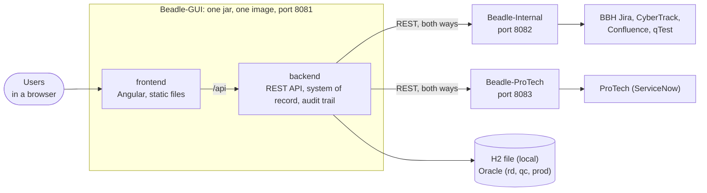
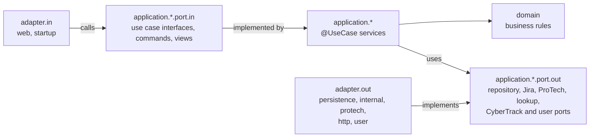
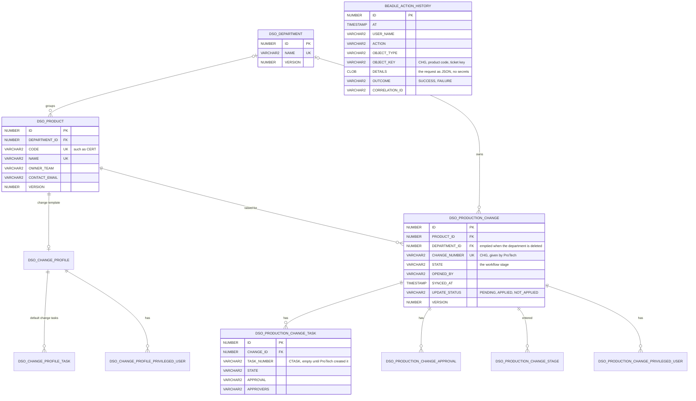

# Beadle-GUI

**Beadle** raises ProTech (BBH's ServiceNow) changes for production releases, their change tasks and their CyberTrack
secure coding tickets, from the change template of each product. It is built from three repositories, described in
[docs/CONTRACTS.md](docs/CONTRACTS.md), the contract every one of them carries:

- **Beadle-GUI** (this repository): the Angular interface and the Spring Boot service behind it, the system of record
  of departments, products, change templates and raised changes, and the audit trail of what users did;
- **Beadle-Internal**: the Spring Boot service that talks to the BBH Jira, CyberTrack, Confluence and qTest with the
  service accounts of Beadle;
- **Beadle-ProTech**: the Spring Boot service that talks to ProTech.

Beadle-GUI is one Angular GUI and one Spring Boot service, packaged as one jar with the GUI inside and as one
container image, with its own database. The three services talk REST, both ways, as the contract describes:
Beadle-GUI reads the BBH Jira and creates CyberTrack tickets through Beadle-Internal, raises, reads, updates and
reminds ProTech changes through Beadle-ProTech, and both call it back when something moved there (see
[Beadle-Internal and Beadle-ProTech](#beadle-internal-and-beadle-protech)).

## Repository layout

```
settings.gradle, build.gradle   the root build: the two modules, repositories, versions, how the jar is packaged
backend/                        the Beadle service (Spring Boot, port 8081), with the Liquibase changelog
frontend/                       the Beadle interface (Angular) and the Groovy browser tests
angular.json, package.json      the Angular workspace with the one project, frontend
deploy/openshift/beadle/        the Kustomize manifests (base and rd, qc, prod overlays); Dockerfile in the root
docs/CONTRACTS.md               the contract between Beadle-GUI, Beadle-Internal and Beadle-ProTech
```

| Module | Holds |
|--------|-------|
| `backend` | the departments, the products with their change templates, the ProTech changes with their change tasks and secure coding tickets, the lookups, signing in with Ping and the signed-in user, the problem detail error handling, the `@UseCase` transaction wiring, the clock, the forwarding of the GUI pages to `index.html`, the REST clients of Beadle-Internal and Beadle-ProTech and the callbacks they send, the Beadle demo data, the Liquibase history and the test support of every suite, with the in-process stand-ins of the two services |
| `frontend` | the application shell (header, menu, signed-in user with Sign out, footer, titles), the sign-in interceptor, the UI kit (form fields, grid, dialogs, toasts), the departments pages and dialogs, the Admin page with its tabs, Changes, New Change, Beadle Admin (Departments, Products with their change templates) and Action History, the API error texts and the browser test support; see [frontend/README.md](frontend/README.md) |

## Build

Needs Java 21, and Node.js 20.19 or a later 20.x with npm 10.8 or a later 10.x on the `PATH` (the build calls `npm`
and `npx` from there, or the paths in `npm.executable` and `npx.executable` of `gradle.properties` when those files
exist). The Gradle wrapper downloads Gradle 8.14 from the BBH Nexus.

```bash
./gradlew build                     # the jar with the GUI inside and every test suite
./gradlew beadleJar                 # the jar only: backend/build/libs/beadle-<version>.jar
./gradlew :backend:bootJar -PskipGui   # the service without its GUI, for API work
./gradlew check                     # every suite of both modules, see Tests
./gradlew sonar                     # SonarQube at tools.bbh.com/sonar, project Beadle, token in SONAR_AUTH_TOKEN
./gradlew publish                   # the jar to the BBH Nexus (bbhNexusUsername and bbhNexusPassword as Gradle properties)
./gradlew beadleJar -PartifactVersion=1.4.0
```

`beadleJar` builds the Angular bundle of `frontend` into the `static` folder of `backend`, so the jar serves the GUI
and the API on one port. `publish` sends a `-SNAPSHOT` version to `nexus.snapshotsUrl` and any other to
`nexus.releasesUrl`, both in `gradle.properties`.

| File | Holds |
|------|-------|
| `settings.gradle` | the two modules; whether the BBH Nexus is reachable, and the repositories that follow from it |
| `build.gradle` | the plugins, Java 21, SonarQube, the npm tasks and test suites of `frontend`, the test suites, coverage gate, packaging and publishing of `backend` |
| `backend/build.gradle`, `frontend/build.gradle` | the dependencies of the module |
| `gradle.properties` | the BBH npm registry, proxy and CA file, the `npm`/`npx` paths on Windows and the Nexus URLs |
| `gradle/libs.versions.toml` | the plugin and library versions |
| `gradle/wrapper/gradle-wrapper.properties` | Gradle 8.14 from the BBH Nexus |
| `angular.json`, `package.json`, `.npmrc` | the Angular workspace: the project `frontend`, the BBH npm registry and the Node.js and npm versions as hard requirements |

The GUI tasks run npm with the `npm.*` properties of `gradle.properties` as npm settings: `installNpmCIDeps`
(`npm ci`), `installDesignSystem` (`npm install --no-save` of the BBH Design System packages `@v6/v6-themes`,
`@v6/v6-table` and `@v6/v6-icons`, inside BBH only), `:frontend:buildAngular` (`npx ng build frontend
--configuration=production` into `frontend/dist`) and `:frontend:testAngular` (`npx ng test frontend --watch=false
--coverage`, Vitest on jsdom, so it needs no browser; the coverage lands in `coverage/frontend`). The
`processResources` of `backend` depends on `buildAngular`, so `bootJar`, `bootRun` and the smoke tests always carry
the current GUI; `-PskipGui` leaves it out.

The BBH Design System packages live only in the BBH npm registry, so `package.json` does not list them and `npm ci`
works anywhere. `-PdesignSystem.packages="@v6/v6-themes@21 @v6/v6-table @v6/v6-icons"` names other versions. The
tables use `ag-grid-enterprise` with only AG Grid's community features so far, so they need no licence; the build hands
BBH's licence key to AG Grid for the day an Enterprise feature is added: `-PagGridLicenseKey=...` or the
`AG_GRID_LICENSE_KEY` environment variable.

### Inside and outside the BBH network

The BBH Nexus, the BBH npm registry and the `njproxy` proxy only answer inside BBH, and the build needs no setting to
know where it is. `settings.gradle` asks the BBH Nexus for the Gradle distribution of the wrapper with one `HEAD`
request (3 seconds to connect): when it answers, plugins and libraries come from the BBH Nexus repositories, npm
packages from `tools.bbh.com/nexus/repository/npm-group` through `njproxy` with the BBH CA file, the Design System is
installed and the GUI builds with the BBH Design System. When it does not, the build says so once ("The BBH Nexus is
out of reach") and uses the Gradle Plugin Portal, Maven Central and `https://registry.npmjs.org/`
(`npm.publicRegistry` names another), switches the `njproxy` proxy properties off, skips `installDesignSystem` and
builds the GUI with the `public` configuration, which swaps the BBH Design System styles and icons for a navy Bootstrap
theme with the same layout. The same build therefore works on a BBH workstation and on any other machine.

`-PbbhNetwork=true` or `false` (also as `bbhNetwork=` in `~/.gradle/gradle.properties`) overrides the check. The
wrapper's own Gradle download sits on the BBH Nexus too, so `gradlew` and `gradlew.bat` make the same check before
they start: when the BBH distribution does not answer, they run the wrapper from a copy in `.gradle/public-wrapper`
whose `distributionUrl` points at `https://services.gradle.org/distributions/gradle-8.14-all.zip`, and Gradle 8.14
is downloaded from there once. `./gradlew build` is therefore the same command everywhere. A machine behind its own
proxy sets `systemProp.https.proxyHost` and `systemProp.https.proxyPort` in `~/.gradle/gradle.properties`, which win
over the project's. Running npm by hand outside BBH needs `--registry=https://registry.npmjs.org/`; `package-lock.json`
resolves every package from `registry.npmjs.org`, which npm maps back to the BBH npm registry inside BBH
(`replace-registry-host`).

## Running locally

Beadle-GUI needs Beadle-Internal and Beadle-ProTech beside it: the contract gives the three services their local
ports, Beadle-GUI 8081, Beadle-Internal 8082 and Beadle-ProTech 8083, so all three run side by side on one machine,
each with the profile `local` on its own H2 file, and all three take the same service token from
`BEADLE_SERVICE_TOKEN`. Any text will do locally, as long as the three share it; without one, Beadle-GUI refuses
every callback and the two services refuse every call of Beadle-GUI.

1. Choose the token and export it in each terminal that starts a service:

   ```bash
   export BEADLE_SERVICE_TOKEN=local-$(whoami)
   ```

2. Start Beadle-Internal and Beadle-ProTech, each in its own clone, and check that they answer the token:

   ```bash
   # in a clone of Beadle-Internal: http://localhost:8082
   ./gradlew bootRun
   curl -H "Authorization: Bearer $BEADLE_SERVICE_TOKEN" http://localhost:8082/api/internal/status
   # in a clone of Beadle-ProTech: http://localhost:8083
   ./gradlew bootRun
   curl -H "Authorization: Bearer $BEADLE_SERVICE_TOKEN" http://localhost:8083/api/protech/status
   ```

   Both run their demo adapters, and their status says `"mode": "demo"`, until the systems behind them are
   configured there: Jira (`JIRA_URL`, `JIRA_TOKEN`) and CyberTrack (`CYBERTRACK_URL`, `CYBERTRACK_TOKEN`) in
   Beadle-Internal, ProTech (`PROTECH_URL`, `PROTECH_USERNAME`, `PROTECH_PASSWORD`) in Beadle-ProTech; their READMEs
   list the rest. A `401` means the token of the terminal differs from the one the service started with.

3. Build and start Beadle-GUI here, then open http://localhost:8081:

   ```bash
   ./gradlew beadleJar
   java -jar backend/build/libs/beadle-0.1.0-SNAPSHOT.jar
   ```

   `./gradlew :backend:bootRun` starts it without building the jar. There is no Ping locally: everybody is signed in
   as `Mateusz Matan` (`BEADLE_SIGNED_IN_USER` names someone else; see [Signing in](#signing-in)).

4. Raise a change in New Change. Beadle-GUI raises it through Beadle-ProTech, whose demo ProTech moves it through the
   approvals every two minutes and calls Beadle-GUI back each time; the change page follows, and Action History shows
   `Change raised` by you, then `ProTech callback` rows by `system:protech` that carry the correlation id of the last
   action on the change (the raise, or the latest time it was opened), which the logs of the three services carry
   too. Creating the secure coding ticket goes through Beadle-Internal the same
   way, and its callback arrives as `system:internal` once the demo CyberTrack moves the ticket.

The services can start in any order and restart on their own: Beadle-GUI asks them again on the next request, and
they send a callback Beadle-GUI did not take again on their next tick. Beadle-GUI reaches the two others at
`beadle.services.internal.url` (`BEADLE_INTERNAL_URL`, `http://localhost:8082` in the `local` profile) and
`beadle.services.protech.url` (`BEADLE_PROTECH_URL`, `http://localhost:8083`), and they call it back at
`http://localhost:8081` (their `BEADLE_GUI_URL`). Beadle-GUI also starts while they are down: the pages then say
"Not reachable. Beadle-ProTech cannot be reached, ..." (or Beadle-Internal) instead of calling it a demo, and whatever
needs them answers 503 naming the service ("Beadle-ProTech did not answer when asked to read the changes: Connection refused"); the
Admin pages and Action History work without them. None of the test suites needs them: they put the in-process
stand-ins of [In-process stand-ins for the tests](#in-process-stand-ins-for-the-tests) in their place.

Beadle starts with the `local` profile: an embedded H2 in Oracle mode in `~/bbh-devsecops/beadle/beadle.mv.db`
(`BEADLE_DATA_DIR` moves the folder) and demo data, so the ProTech workflow can be tried at once; `BEADLE_DEMO_DATA=false`
starts it empty but for the five BBH departments (AI Lab, Capital Partners, Corporate Technology, Custody and Fund
Services). Everybody is signed in as `Mateusz Matan` (`BEADLE_SIGNED_IN_USER`), without Ping: the `local` profile
sets `beadle.auth.mode` to `local` (see [Signing in](#signing-in)). Liquibase creates the schema on the first start
and updates it in place when a new version adds to it; every later start finds the data where it was left. Jira, ProTech and CyberTrack are whatever Beadle-Internal and
Beadle-ProTech connect them to: their demo adapters until their URLs are set there, and the pages say so with a "Demo
mode" banner (see [Beadle-Internal and Beadle-ProTech](#beadle-internal-and-beadle-protech)).

On `rd`, `qc` and `prod` Beadle runs on Oracle:

```bash
SPRING_PROFILES_ACTIVE=qc DB_URL=jdbc:oracle:thin:@//<host>:1521/<service> DB_USERNAME=BEADLE DB_PASSWORD=... \
  PING_ISSUER_URI=https://<ping>/as PING_CLIENT_ID=... PING_CLIENT_SECRET=... \
  java -jar backend/build/libs/beadle-0.1.0-SNAPSHOT.jar
```

Each of the three profiles belongs to the group `oracle` (the data source from `DB_URL`, `DB_USERNAME` and
`DB_PASSWORD`, `ddl-auto: validate`, no demo data) and signs users in with Ping; `rd` logs at DEBUG. None of them
shows the health details (`show-details: never`): `/actuator/health` is open to anyone who reaches the route, so it
answers only `UP` or `DOWN`, and only the `local` profile shows the database and disk details. A profile without `DB_URL`, `BEADLE_INTERNAL_URL`, `BEADLE_PROTECH_URL`,
`PING_CLIENT_ID`, `PING_CLIENT_SECRET` or `PING_ISSUER_URI` does not start, and Beadle reads the Ping configuration
from the issuer when it starts, so the issuer has to answer then. Behind a proxy or the OpenShift route they take the
scheme and host of their own address from its `X-Forwarded-*` headers (`server.forward-headers-strategy: native`), so
the address Ping sends the browser back to is the `https` one of the route.

For GUI work, the Angular development server rebuilds on every change and proxies `/api`, `/logout`, `/oauth2` and
`/login` to the service (`frontend/proxy.conf.json`), so signing out works there, and so does signing in with Ping when
the service runs in mode `oidc` and Ping knows `http://localhost:4201/login/oauth2/code/ping`: the proxy keeps the
`Host` of the development server, so the service builds its addresses on port 4201. `npm start` serves the GUI on
http://localhost:4201 against port 8081; `npm run start:public` does the same without the BBH Design System.

### Configuration

The service reads `backend/src/main/resources/application.yml`: JPA, Liquibase, the actuator health and info, and
under the prefix `beadle.` its own settings, one document per profile.

| Variable | Default | Meaning |
|----------|---------|---------|
| `PORT` | `8081` | HTTP port |
| `SPRING_PROFILES_ACTIVE` | `local` | `local` runs on H2, `rd`, `qc` and `prod` on Oracle (`rd` logs at DEBUG) |
| `BEADLE_DATA_DIR` | `~/bbh-devsecops/beadle` | the folder of the H2 database `beadle.mv.db` of the `local` profile |
| `DB_URL`, `DB_USERNAME`, `DB_PASSWORD` | H2 with `local`; required with `rd`, `qc`, `prod` | the database of the active profile |
| `DB_POOL_SIZE` | 5, 10, 20 in `rd`, `qc`, `prod` | Oracle connection pool size |
| `BEADLE_DEMO_DATA` | `true` with `local`, `false` otherwise | the demo products with their change templates, nothing more: the changes are raised by the users and their state comes from Beadle-ProTech; see [Beadle demo data](#beadle-demo-data) |
| `BEADLE_AUTH_MODE` | `local` with `local`, `oidc` otherwise | how users sign in (`beadle.auth.mode`): `oidc` with Ping, `local` as `BEADLE_SIGNED_IN_USER` without a sign-in; see [Signing in](#signing-in) |
| `BEADLE_SIGNED_IN_USER` | `Mateusz Matan` | the user everybody is signed in as when `BEADLE_AUTH_MODE` is `local` (`beadle.signed-in-user`) |
| `PING_ISSUER_URI` | none; required with `rd`, `qc`, `prod` | the Ping issuer (`spring.security.oauth2.client.provider.ping.issuer-uri`), whose OpenID configuration Beadle reads when it starts |
| `PING_CLIENT_ID`, `PING_CLIENT_SECRET` | none; required with `rd`, `qc`, `prod` | the OpenID Connect client of Beadle at Ping (registration `ping`) |
| `BEADLE_INTERNAL_URL` | `http://localhost:8082` with `local`; required with `rd`, `qc`, `prod` | where Beadle-Internal answers (`beadle.services.internal.url`): Jira and CyberTrack |
| `BEADLE_PROTECH_URL` | `http://localhost:8083` with `local`; required with `rd`, `qc`, `prod` | where Beadle-ProTech answers (`beadle.services.protech.url`): ProTech and its lookups |
| `BEADLE_SERVICE_TOKEN` | empty: every callback is refused | the token the three Beadle services share (`beadle.services.token`): sent as `Authorization: Bearer` with every call to Beadle-Internal and Beadle-ProTech and required of their callbacks; trimmed, as the two others trim theirs, so the newline a secret made with `--from-file` keeps does no harm |

`beadle.gui.pages` (`changes, new-change, admin, action-history`) names the pages of the interface the service forwards to
`index.html`. The log lines carry the correlation id of the request they belong to (`[%X{correlationId}]`, set by
`logging.pattern.correlation`).
Liquibase runs on every start, on H2 and on Oracle. Secrets come from environment variables that OpenShift fills from
secrets; none is written to the repository, a log or a test fixture.

## Containers and OpenShift

The `Dockerfile` in the repository root builds the image: the Spring Boot jar with its Angular GUI inside, on the Red
Hat UBI 9 OpenJDK 21 runtime, its layers extracted, running as a non-root user and also under the arbitrary UID
(group 0) that OpenShift assigns, so it fits the default `restricted-v2` security context constraint.

```bash
./gradlew beadleJar
docker build -t beadle:0.1.0-SNAPSHOT .
docker run --rm -p 8081:8081 beadle:0.1.0-SNAPSHOT
```

The build context is the repository root, whose `.dockerignore` lets only the application jar through, so build the
jar first. To build on an internal mirror of the base image, pass `--build-arg BASE_IMAGE=<mirror>/ubi9/openjdk-21-runtime:<tag>`;
Podman and Buildah accept the same arguments. The container starts the `local` profile: H2 in `/application/data`
(`BEADLE_DATA_DIR`) with the demo products; give it a volume (`-v beadle-data:/application/data`) to keep its H2
database (the products, their change templates, the changes raised and the audit trail) across restarts, or
`-e SPRING_PROFILES_ACTIVE=rd` with the `DB_*` variables to run it on Oracle.

The manifests in `deploy/openshift/beadle` are a Kustomize base (Deployment, Service, Route and the ConfigMap
`beadle-config`) with one overlay per environment, `rd`, `qc` and `prod`, each starting the Spring profile of the
same name:

1. Push the image to a registry the cluster can pull from and point the overlay at it:

   ```bash
   cd deploy/openshift/beadle/overlays/rd
   kustomize edit set image beadle=<registry>/<project>/beadle:0.1.0-SNAPSHOT
   ```

2. Create the database secret in the target project; the values never go into the repository:

   ```bash
   oc create secret generic beadle-db \
     --from-literal=DB_URL='jdbc:oracle:thin:@//<host>:1521/<service>' \
     --from-literal=DB_USERNAME='<user>' \
     --from-literal=DB_PASSWORD='<password>'
   ```

   The service token the three Beadle services share goes into its own secret, with the same value as the
   `beadle-internal-services` and `beadle-protech-services` secrets of Beadle-Internal and Beadle-ProTech:

   ```bash
   oc create secret generic beadle-services --from-literal=BEADLE_SERVICE_TOKEN='<token>'
   ```

   The OpenID Connect client Ping registered for Beadle in this environment goes into `beadle-oidc`; Ping has to know
   `https://<route>/login/oauth2/code/ping` as a redirect URI of the client and `https://<route>/` as its address
   after signing out:

   ```bash
   oc create secret generic beadle-oidc \
     --from-literal=PING_CLIENT_ID='<client id>' \
     --from-literal=PING_CLIENT_SECRET='<client secret>'
   ```

   Its issuer goes into the overlay itself, since it is no secret: each overlay carries the placeholder
   `PING_ISSUER_URI=https://set-the-ping-issuer-of-<environment>.invalid`, which keeps the pod from starting (Beadle
   reads the Ping configuration from the issuer when it starts, and the reserved domain `.invalid` never answers).
   Replace it with the issuer Ping names for the client, commit the overlay, and check that no placeholder is left:

   ```bash
   sed -i 's|^\( *- PING_ISSUER_URI=\).*|\1https://<ping issuer of rd>|' deploy/openshift/beadle/overlays/rd/kustomization.yaml
   grep -rn 'set-the-ping-issuer' deploy/openshift/beadle/overlays/rd && echo 'Set PING_ISSUER_URI first'
   ```

3. Beadle-Internal and Beadle-ProTech run in the same project as the Services `beadle-internal` (port 8082) and
   `beadle-protech` (port 8083); `BEADLE_INTERNAL_URL` and `BEADLE_PROTECH_URL` in the overlay's
   `configMapGenerator` name them (`http://beadle-internal:8082`, `http://beadle-protech:8083`), and they call Beadle-GUI
   back at `http://beadle:8081`. Then apply the overlay:

   ```bash
   oc apply -k deploy/openshift/beadle/overlays/rd
   oc rollout status deployment/beadle
   oc get route beadle
   ```

Liquibase updates the Oracle schema when the pod starts. Beadle keeps no file of its own and the sessions live in the
pod, so its Deployment rolls out with `RollingUpdate` and no downtime, and a user whose pod went away is sent through
Ping again, which signs a known browser back in at once (with more than one replica the Route needs its default
sticky sessions). The startup probe allows three minutes for Liquibase, and the liveness and
readiness probes use `/actuator/health/liveness` and `/actuator/health/readiness`. The route terminates TLS at the
edge and redirects plain HTTP. Memory is limited to 1 GiB per pod with the heap at 75% of it; change `resources` in an
overlay patch if an environment needs more.

| Variable | Source | Purpose |
| --- | --- | --- |
| `SPRING_PROFILES_ACTIVE` | ConfigMap `beadle-config` | `rd`, `qc` or `prod`; each runs on Oracle |
| `DB_URL`, `DB_USERNAME`, `DB_PASSWORD` | Secret `beadle-db` | Oracle connection |
| `DB_POOL_SIZE` | ConfigMap (optional) | Connection pool size, defaults per profile |
| `BEADLE_AUTH_MODE` | ConfigMap `beadle-config` | `oidc`: users sign in with Ping |
| `PING_ISSUER_URI` | ConfigMap `beadle-config`, set in each overlay over its placeholder | The Ping issuer of the environment |
| `PING_CLIENT_ID`, `PING_CLIENT_SECRET` | Secret `beadle-oidc` | The OpenID Connect client of Beadle at Ping |
| `BEADLE_INTERNAL_URL`, `BEADLE_PROTECH_URL` | ConfigMap `beadle-config` | Where Beadle-Internal and Beadle-ProTech answer, `http://beadle-internal:8082` and `http://beadle-protech:8083` |
| `BEADLE_SERVICE_TOKEN` | Secret `beadle-services` | The token the three Beadle services share; Jira, CyberTrack and ProTech are configured in Beadle-Internal and Beadle-ProTech |

## Beadle

Beadle's menu has four sections:

- **Changes**: the ProTech changes of your department. Pick your department (the browser remembers it) and see its
  changes in a table you can sort and filter in the header: change number, product, FixVersion, the ProTech workflow
  state with what it means ("Waiting for the L1 approver"), the installation window, the short description, the
  number of change tasks and when it was raised; **Raise a change** opens New Change. Opening a change reads it from
  ProTech first, so what was changed there (texts, schedule, fields, approvals, CTASKs and their states) shows at
  once. "Where the change is" names its state, what it waits for (the approver by name, or how many change tasks are
  approved) and the workflow progress through Draft, Business Approval, Primary Approval, Secondary Approval, Support
  Approval, CTask approval, Escalated approval, In Progress and Closed; **Approvals** lists the business, L1, L2 and
  support approvals and the approval of every change task, each with its approvers, its state (Not Approved,
  Requested or Approved) and its last reminder, with a discreet **Remind** on each approval still awaited and
  **Remind everyone who has not approved** for the whole change (see [Approvals and reminders](#approvals-and-reminders));
  "The change at a glance" shows when it installs and what it delivers; then come its change tasks, each with every
  field of the change task form, read-only, and its state in words, and two collapsed panels: "All ProTech fields",
  with its change number, approval (Not Approved in Draft, Requested in the approval stages, Approved from In Progress
  on) and who opened it, and "Text sent to ProTech". An open change
  can be edited by its department with **Edit the change** (**Edit change** in its row), in the same sections as New
  Change: the update is published to ProTech at once, and Beadle checks and shows whether ProTech applied it (the row
  says "Update pending" until then). While an open change of your department has no secure coding ticket, a note on
  its page offers **Create the secure coding ticket** (see [Secure coding ticket](#secure-coding-ticket)). While Jira,
  ProTech or CyberTrack is not connected, a "Demo mode" banner on Changes and New Change says so; while Beadle-ProTech
  or Beadle-Internal does not answer at all, a "Not reachable" banner says what cannot be done until it answers again.
- **New Change**: the guided wizard that raises a change for a production release. A bar shows its steps with their
  numbers: eight until the change is created ("Step n of 8" heads each one), then **Add CTASKs** and **Secure
  coding** join them and a **Summary** ends the wizard. The button at the bottom names the next step (**Next: Jira**).
  Choose the department and the product: the product's change template fills in every step, and each value can be
  changed for this change. A magnifier next to a person, the department, the assignment group, the release, the
  affected CI, the incident, the problem and the affected clients searches ProTech (see [Lookups](#lookups)) and fills
  the field with the value picked (affected clients adds it to the list); every such field also takes free text. The
  steps:
  1. **Request details**, in two columns: the change number (given by ProTech when the change is raised), approval
     (Not Approved), Opened by (the signed-in user) and state (Draft), all read-only; then requested for,
     requested by, department, assignment group, category, assigned to, type, release, affected CI, incident, direct
     business service, problem, risk, affected clients and users affected. Requested for, requested by and assigned to
     default to the signed-in user and the department to the product's department; the direct business service comes
     with the CI picked from the search and the risk is worked out from the risk assessment, so neither is typed.
  2. **Jira**: type the FixVersion, the Jira release the change delivers (the known versions are offered, unreleased
     first, and one typed in another case takes Jira's spelling); its epics are listed, and choosing epics loads their
     stories. The short description and the description are written from the choice under "Text sent to ProTech" and
     stay editable.
  3. **Approval and notification**: business approver, L1 approver, L2 approver and support approver.
  4. **Schedule**: the installation start and its hours, the post-install validation start and its hours, the first
     use and, when the change has downtime, the downtime start and its hours, which default to the installation
     window. The template's start time and hours are the defaults, on the release date of the FixVersion while that
     start is still ahead, otherwise on the next day.
  5. **Planning**: test summary, implementation plan, validation plan, backout plan and first use plan.
  6. **Privileged access**: how many privileged accounts (none to seven), each on one line: the person (with a
     magnifier) on the left and the privileged access on the right.
  7. **Risk assessment**: nine questions in two columns, each answered from a fixed list; the template's answers are
     the defaults.
  8. **Review**: every value of the change and the text sent to ProTech, which can still be changed; **Create and add
     CTASKs and SecureCoding ticket** creates the change (CHG) in ProTech, which gives it its number. A CTASK can
     only be created under a CHG that exists, so the two steps that need the number follow.
  9. **Add CTASKs**: the change tasks (CTASK) of the created change, prefilled from the default change tasks of the
     template (see [Change tasks](#change-tasks)) and created against its number with **Create the CTASKs in
     ProTech**; **Add CTASKs later** skips them, and **Edit the change** on the change page adds them afterwards.
  10. **Secure coding**: the secure coding ticket of the change in CyberTrack (see
      [Secure coding ticket](#secure-coding-ticket)), its inputs filled in from the template; **Create the secure
      coding ticket in CyberTrack** creates it, and **Create the ticket later** leaves it to the change page.
  11. **Summary**: the change number and the secure coding ticket number (both read-only), the FixVersion, the
      installation window, the change tasks and what happens next, with **Open the change** and **Create another
      change**.
- **Admin**, in two tabs: **Departments** (add, rename and delete departments, each with the number of its products
  and of the changes raised for them; a department with products or changes cannot be deleted, and a disabled Delete
  says why) and **Products**: every product by department with the state of its change template, "Filled in" (with
  when it was saved) or "Not filled in yet". Add a product with its name, product code, department, owner team and
  contact e-mail; its page opens next. On its page **Edit details** changes its name, department, owner team and
  contact e-mail (a name another product has keeps the dialog open with your edits), **Delete product** deletes it
  with its change template, and its **change template** keeps the ProTech fields in the sections and order of New
  Change and the default change tasks of its changes. Until the template is saved, the new changes of the product
  start with values suggested from its name, code and owner team.
- **Action History**: the audit trail (see [Audit trail](#audit-trail)), newest first, in pages of 25, 50, 100 or 200
  rows with **Previous** and **Next**: when (to the second, in your time zone), who, which action, the object (the
  change number, product code, department, ticket key or user), the outcome and the correlation id. Filter it by user
  and action (both lists hold the values recorded so far), by the beginning of the object key, by outcome and by the
  first and last day; every filter asks the API again from the first page, and **Clear filters** shows everything
  again. A row, or its time, opens the details of the action: the request it was given as JSON (secrets masked) and
  the message of a failure.

Beadle's products are its own: a product is a name, a code, a department, an owner team and a contact e-mail, enough
to raise changes for it. ProTech knows no services or pipelines, so Beadle neither stores nor shows them.

### Change templates

Every product has a **change template**, kept by the administrator in Beadle Admin on the product's page:

- **Request details**: requested for, requested by, department, assignment group, category, assigned to, type,
  release, affected CI, incident, direct business service, problem, affected clients and users affected. The category
  is one of Application, Hardware, Infrastructure, System Software, Network, Telecom, Data Amendment, Desktop
  Software, Storage, Facilities, Other and Database, and the type one of Standard, Emergency, Business Critical and
  Model. An empty requested for, requested by or assigned to means the user who raises the change, and an empty
  department the department of the product, as the notes under those fields say ("If left empty: the user who opens
  the change", "If left empty: the department of the product").
- **Jira**: the Jira project key the epics and stories of a release come from.
- **Approval and notification**: business approver, L1 approver, L2 approver and support approver.
- **Schedule defaults**: downtime yes or no, the installation start time, how many hours the installation takes and
  how many hours the post-install validation takes.
- **Planning**: test summary, implementation plan, validation plan, backout plan and first use plan.
- **Privileged access**: yes or no; when yes, up to seven users, each with the name of their privileged account.
- **Risk assessment**: nine questions, each answered from its list (below); an answer left out is the first of its
  list.
- **Secure coding**: the defaults of the secure coding ticket: APO number, Bitbucket URL, artifact link and QC
  application link (see [Secure coding ticket](#secure-coding-ticket)).
- **Change tasks**: the default CTASKs of a change, one to fifty, in the same form as
  [Change tasks](#change-tasks); the fields the change gives a task (the number, the change number, the approval and
  its approvers, the installation window and the task start) stay empty and say where their value comes from.

| Question | Answers |
|----------|---------|
| Number of BBH workgroups impacted (`bbhWorkgroups`) | Single, 2-3, More than 3 |
| Complexity of the change (`changeComplexity`) | Simple, Moderate, Very |
| Number of BBH users impacted (`bbhUsers`) | Less than 5, 5-25, 26-250, All users |
| Complexity of validation (`validationComplexity`) | Simple, Moderate, Very |
| Number of applications impacted (`bbhApplications`) | Single, Two, More than 2 |
| Backout testing & duration (`backoutTesting`) | Less than 30 minutes, 30 mins - 2 hours, Greater than 2 hours, Unable to test |
| Number of impacted clients outside BBH (`clientsOutsideBbh`) | No clients, Single, More than one but not all, All clients |
| Platform status (`platformStatus`) | Existing, New, Decommissioned |
| Business impact (`businessImpact`) | None, Low, Medium, High |

A category, a type or an answer off its list is refused with 400 on that field, for example
`riskAssessment.bbhUsers`. The lists live once in the domain (`ChangeTemplate`, `RiskAssessment`) and reach the GUI
through `GET /api/changes/options`. Nobody types the **risk**: Beadle works it out from the answers whenever a
template or a change is read or saved, and ignores a risk it is sent. It is **High** when any answer is the last of
its list (More than 3, Very, All users, More than 2, Unable to test, All clients, Decommissioned, High), else
**Moderate** when any answer is past the first of its list, else **Low**.

A product without a saved template gets suggested values from its code, name and owner team (category Application,
type Standard, the product as affected CI), and two suggested change tasks: "Deploy <product> to production" for
Release Management with the product as its application, and "Validate <product> in production" for the assignment
group of the template.

### Lookups

The magnifiers of the wizard and of the template form search ProTech through the out port `ProTechLookupPort` with
`GET /api/lookups/{kind}?q=`: `users`, `departments`, `assignment-groups`, `releases`, `configuration-items`,
`incidents`, `problems` and `clients`. Each answer holds at most 20 entries that contain the text, ignoring case,
in their `value` (what fills the field) or their `detail` (an e-mail address, a cost centre, the department, the
product code, the business service or a short description); an empty text lists the first 20. Beadle-ProTech
answers them (`GET /api/protech/lookups/{kind}?q=&limit=20`), from ProTech or from its demo lookups.

### Signing in

Users sign in to Beadle with Ping, BBH's OpenID Connect provider, through Spring Security's OAuth2 login
(`config/SecurityConfiguration`); `beadle.auth.mode` (`BEADLE_AUTH_MODE`) picks one of two modes:

- `oidc`, the default and the mode of `rd`, `qc` and `prod`: the registration `ping` with the client of
  `PING_CLIENT_ID` and `PING_CLIENT_SECRET`, the issuer of `PING_ISSUER_URI` and the scopes `openid profile email`.
  A browser without a session opens the interface as usual (the pages and static files are public), its first API call
  answers `401` and the interface sends it to `/oauth2/authorization/ping`; Ping signs it in (at once when it knows
  the browser) and sends it back through `/login/oauth2/code/ping` to `/`, and the interface opens the page it was on
  (kept in the tab's session storage while the browser is away). `/api/**` needs the session; an API call without one
  always answers `401`, never a redirect, while any other protected address such as `/actuator/info` redirects a
  browser to Ping. Every change (`POST`, `PUT`, `DELETE`) carries the CSRF token of the session: Beadle sets it in the
  cookie `XSRF-TOKEN`, which the interface reads, and the interface sends it back as `X-XSRF-TOKEN`; a change without
  it is refused with `403`.
- `local`, the mode of the `local` profile and of the tests: no Ping and no CSRF token; every request is signed in as
  `beadle.signed-in-user` (`BEADLE_SIGNED_IN_USER`, `Mateusz Matan` by default).

`/api/callbacks/**` and `/actuator/health/**` take no session in either mode: the callbacks of Beadle-Internal and
Beadle-ProTech carry the service token instead (see [Callbacks](#callbacks)), and the health probes of OpenShift are
open. `POST /logout` ends the session at Beadle. In mode `oidc` it ends the Ping session as well (OpenID Connect
RP-initiated logout, `config/PingSignOut`): since the interface posts it by XHR and cannot follow a redirect to Ping,
Beadle answers `200 {"redirectUrl": "..."}` with the `end_session_endpoint` of Ping's OpenID configuration, the
`id_token_hint` of the session and `post_logout_redirect_uri=https://<route>/`, and the header's **Sign out** sends
the browser there. Ping ends its session and sends the browser back to `/`, whose first API call goes to the Ping
sign-in, which now asks for the password instead of signing the browser straight back in. A PingFederate that only
advertises `ping_end_session_endpoint` gets that one with `TargetResource=https://<route>/`; an issuer that advertises
neither leaves `redirectUrl` at `/`, which ends Beadle's session only. In mode `local` it answers `204` and the
interface opens `/`.

The signed-in user sits behind the out port `SignedInUserPort` (`adapter/out/user/AuthenticatedUserAdapter`): the
claim `name` of the ID token, else `preferred_username`, else `sub`, and the claim `email`; the name of the local
user in mode `local`. `GET /api/me` answers `{"name": "...", "email": "..." or null}`, and the header shows the name
next to the sections, with the email address as its tooltip. The first authenticated API call of every session
records `USER_SIGNED_IN` in the audit trail (`SignInRecorder`, once per session; signing out and in again records it
again). The name goes into every audit row and into the `X-Beadle-User` header of every call to Beadle-Internal and
Beadle-ProTech, which only log it: Jira, CyberTrack and ProTech see the service accounts of Beadle. The wizard shows it
as Opened by, raising a change stores it as the change's `openedBy`, and it fills an empty requested for, requested by
and assigned to of the template; an empty department becomes the product's department.

Beadle is registered at Ping as a confidential OpenID Connect client of each environment: the authorization code
grant, the redirect URI `https://<route>/login/oauth2/code/ping`, the post-logout redirect URI `https://<route>/`, the
scopes `openid profile email`, and an ID token
that carries `name` (or at least `preferred_username`) and `email`. Beadle reads the issuer's OpenID configuration
when it starts, so a wrong `PING_ISSUER_URI` stops the start, as does a missing Ping variable on `rd`, `qc` and `prod`;
mode `oidc` without the registration (the `local` profile with `BEADLE_AUTH_MODE=oidc`) stops it with
"beadle.auth.mode=oidc needs the Ping registration ...", since the registration lives in those three profiles only. The session is Beadle's
own HTTP session, ended by Sign out, after 30 minutes without a request (`server.servlet.session.timeout`) or when the
pod that held it goes away; the next API call then goes through Ping again and comes back to the page it was on. A
page with unsaved changes (New Change, Edit the change, the secure coding ticket of a change, the change template of a
product) does not leave at once: a "Your session ended" dialog offers **Sign in again** and **Stay on this page**, to
copy what was typed first (`core/session-end.ts`). New Change keeps its entries in the tab's session storage
(`beadle.signIn.draft`) and opens again on the same step with them after the sign-in: the department, the product and
its template as edited, the FixVersion with the chosen epics and stories, the schedule and the texts the user wrote,
and once the change is raised, the change tasks and the secure coding ticket of that change, which it does not raise
again. The other three pages say that their changes are lost with the new sign-in. The tests run in mode `local`,
except `SecurityConfigurationSpec`, which checks both modes against a made-up Ping whose OpenID configuration is read
from a local server, and `PingSignOutSpec`, which checks the end-session addresses.

### Raising a change

New Change starts from the template and lets the app owner change any field for this change. It adds what changes
this time: the Jira FixVersion with its epics (the epics that carry the FixVersion or have a story that does) and the
chosen epics' stories that carry it, and the schedule: installation start and end, post-install validation start and
end and first usage, in that order, the installation in the future, and the downtime window. A change with downtime
needs the downtime start and end, the end after the start ("choose when the downtime starts"); a change without
downtime must leave both empty ("must be empty without downtime"). Beadle asks Jira again when the change is previewed
or raised and refuses an epic or story the FixVersion does not list. A FixVersion typed in another case is stored as
Jira spells it, and one Jira does not list is kept as typed. The release is the FixVersion unless the template or the
user name another, and the people and the department left empty are filled as [Signed-in user](#signed-in-user)
describes. The short description names the product, the FixVersion and the epics; the description names the product,
its department and the schedule with the downtime window (or "No downtime"), lists every epic with its chosen stories,
then the planning texts, privileged access, the risk with every answer, the users affected and the secure coding
ticket once it exists, cut to the 160 and 4000 bytes ProTech takes. Both stay editable until the change is raised;
each new preview writes them again, keeping a text the user edited and offering the new one. The change belongs to the
department of its product, so New Change lists only the products in a department. A raised change is stored in Beadle
with its numbers, who opened it, its texts, its tasks and a copy of the fields it used, so it outlives later edits of
the template and the product itself; it starts in Draft.

### Change tasks

ProTech creates a change task (CTASK) only under a change it holds, so New Change raises the change first and then
creates its change tasks one by one against the new CHG number (`POST /api/changes/{id}/tasks`); an open change gets
more on its Edit page. One task form serves adding, editing and viewing (read-only, on the change page and without
the magnifiers). It lays its fields out compactly in two columns, left then right, with the text areas one under
another across the width, and its assignment group decides which fields it has. A group whose name contains "Release
Management" (ignoring case) makes a release task:

- number (given by ProTech) and change number;
- assignment group and assigned to, each with a magnifier;
- approval (Not Approved, Requested or Approved in ProTech) and approvers (named by ProTech from the assignment group
  once it created the task);
- affected CI (the affected CI of the change when left empty) and platform (None, Mainframe, Distributed, OpenShift
  or Cognos/Motio; None by default);
- installation start and end, from the change;
- task start, at least a minute after the installation start and not after its end (one minute after the
  installation start by default);
- application (OCP on OpenShift, free text otherwise), packages and backout packages;
- short description, description and additional comments.

Any other group, for example Cloud Engineering, Data Movement - API or OIS Support, has the number, the change
number, the assignment group, assigned to, the approval and its approvers, importance (1 - Critical, 2 - High,
3 - Moderate, 4 - Low or 5 - Planning; 3 - Moderate by default), the affected CI, the installation start and end, the
short description, the description and additional comments. Changing the group changes the form, and the fields the other kind has are
neither sent nor stored. A short description takes up to 160 bytes, a description 4000, packages, backout packages
and comments 2000, the group, the person and the CI 200, and the application 100. A change holds at most fifty tasks,
and a schedule moved on the Edit page keeps the start of every release task inside the new installation window or
is refused at that task. Every change task has its own approval; see [Approvals and reminders](#approvals-and-reminders).

### Approvals and reminders

A change has four approvals of its own, asked by ProTech in this order: the business approver, the L1 approver, the
L2 approver and the support approver named on the change (from the template, changeable in New Change and on the
Edit page). Then every change task has its own, separate approval, asked from the approvers ProTech names for the
task's assignment group, so each change task has different approvers. Every approval is **Not Approved** (not asked
yet), **Requested** (asked, waiting) or **Approved**. Beadle reads the approvals of the change and of its tasks from
ProTech with the change and shows them in **Approvals** on the change page and in the Approval and Approvers fields
of each task. The change goes **In Progress** (ProTech's Implementation state) only once every change task that is
not canceled is approved: a change without change tasks waits in CTask approval, and a change task added later, or
moved to another assignment group, sends the change back to CTask approval. Beadle holds to this rule itself: when
ProTech reports Implementation while a change task is still waiting, Beadle shows the change in CTask approval.

Each approval still awaited that names someone has a discreet **Remind** button, and **Remind everyone who has not
approved** reminds them all at once: the business, L1, L2 and support approvals that are Not Approved or Requested and
the change tasks not approved yet. Beadle reads the change from ProTech first, asks ProTech to send each reminder
(`POST /api/changes/{id}/reminders`) and keeps the last reminder of every approval, when it went and to whom, shown
under Last reminder ("James Carter, 2 minutes ago"); a message names everyone it reached. Only the department of the
change can remind its approvers (403 otherwise, and the buttons say why while they are disabled); a closed change, an
approval already approved or one without anybody named is refused with 409 and the reason, both an approval and a
change task, or a change task the change does not have, with 400, and an unreachable ProTech with 503. When ProTech
refuses a reminder after others went out, those sent are kept. A reminder changes no approval and does not make an
editor's version stale.

### Secure coding ticket

Every change gets a secure coding ticket in CyberTrack, the Jira project SCP. It is created after the change, in the
Secure coding step of New Change or with **Create the secure coding ticket** on the change page
(`POST /api/changes/{id}/secure-coding`), from five inputs, all required:

- **APO number**: the ID of the application in Apollo (up to 40 bytes);
- **Implementation date**: the day the installation starts, written MMDDYYYY (10152026), filled in from the change;
- **Bitbucket URL**: the repository, for the SAST scan;
- **Artifact link**: the build in Jenkins or the artifact in Nexus, for the OSA (Nexus IQ) scan;
- **QC application link**: the application on QC, for the DAST scan.

The links must start with `https://` or `http://` and take up to 500 bytes. The change template keeps the APO number
and the three links as defaults. The ticket's summary is `APO-ID_APP-NAME-IMPLEMENTATION-DATE`, for example
`APO-31337_CertScanner-10152026` (the application name is the product's name), and its description lists every input
and the change number. Beadle then stores the ticket number with the inputs and publishes it to ProTech as the
change's secure coding ticket number, like any update (see [Editing a change](#editing-a-change)). A change that
already has a ticket, a closed change, another department, a stale version or a pending update is refused as an
update is; when CyberTrack created the ticket but ProTech refuses it, the message names the ticket to enter with
**Edit the change**.

CyberTrack sits behind the out port `CyberTrackPort`, which Beadle-Internal serves: `InternalCyberTrackAdapter`
sends the change number, the application name, the implementation date as an ISO date (`2026-10-15`) and the four
inputs to `POST /api/internal/cybertrack/tickets` and takes the key of the new ticket from the answer. Beadle-Internal
creates the issue in CyberTrack with the service account of Beadle (or numbers demo tickets `SCP-nnnn` while
CyberTrack is not configured there), and tells Beadle-GUI when the ticket changes status (see
[Callbacks](#callbacks)).

### Synchronisation and the workflow

Beadle reads a change from ProTech every time it is opened (also a closed one) and reads all open changes of the list
in one call when the Changes tab is opened; a closed change in the list is not read again. Whatever ProTech holds wins:
the texts, the schedule, the fields of the template (except the Jira project, the type and the schedule defaults,
which stay as raised), the change tasks and their states (Open, Work in progress, Closed, Canceled), the approvals of
the change and of its tasks with their approvers, the workflow state and the time each stage was entered, and the
link; the reminders Beadle sent stay with their approvals. Right after it created change tasks Beadle reads the change
again, so the new tasks show their approvers at once. A change that read differently is stored at a new version;
one that read the same only records the time it was read. The change also keeps the version at which a field Beadle
edits last changed (`editedVersion`), so an editor's version only goes stale when someone updated the change in
Beadle or ProTech changed its texts, fields or tasks, not when ProTech moved it through the workflow, an approval or a
task changed state, or someone sent a reminder. When ProTech cannot be reached, Beadle shows what it read last with "ProTech could not be reached: ..." and
**Try again**; a change ProTech does not hold says "ProTech has no change CHG...".

The workflow of a change is Draft, Business Approval, Primary Approval, Secondary Approval, Support Approval, CTask
approval, Escalated approval (only for a change at short notice), In Progress (Implementation in ProTech) and Closed.
A change reaches In Progress only once every change task is approved.

### Editing a change

An open change (any state but Closed) can be changed by a user of its department: the texts, the schedule with its
downtime window, the template fields except the Jira project, the type and the schedule defaults, and the change
tasks. A task that ProTech has not created yet is added, a task left out is canceled in ProTech, a canceled task
cannot be sent again, and a closed task can neither be changed nor removed. Beadle checks that nobody changed the
edited fields since the version the user read and that the last update is no longer pending, then reads the change
from ProTech: a change closed meanwhile is refused, and so is one whose texts, fields or tasks ProTech changed since
the user opened it, so the update never overwrites them. Beadle then publishes the update to ProTech at once and reads
the change back. The change carries the status of the update, with the department that sent it and the fields ProTech
has not applied:

- **PENDING**: ProTech has not applied every field yet; the change shows the values that were sent, and every later
  read checks again. The change page checks every few seconds; when ProTech takes longer than usual it stops and
  offers **Check again**.
- **APPLIED**: ProTech holds every value that was sent.
- **NOT_APPLIED**: ProTech still differs one minute (`ProductionChange.APPLY_LIMIT`) after the update was sent; the
  change shows ProTech's values and the fields that were not applied, and **Edit the change** sends them again.

Only the department of the change may update it (403 otherwise; a change without a department cannot be changed in
Beadle, and a department that owns changes cannot be deleted), a stale version, a change ProTech changed meanwhile, a
change whose last update is still pending or a closed change is refused with 409, and an unreachable ProTech with
503. Reading and publishing hold no database transaction while ProTech answers; when two requests store the same
change at once, a read shows the copy the other request stored.

### Beadle-Internal and Beadle-ProTech

Jira sits behind `JiraPort`, CyberTrack behind `CyberTrackPort`, ProTech behind `ProTechPort` and its searches behind
`ProTechLookupPort` (see [Lookups](#lookups)). Beadle-GUI talks to none of these systems itself: its adapters are
REST clients of the two other Beadle services, on the endpoints of [docs/CONTRACTS.md](docs/CONTRACTS.md).

| Port | Adapter (`backend/.../adapter/out`) | Calls |
|------|-------------------------------------|-------|
| `JiraPort` | `internal/InternalJiraAdapter` | `GET /api/internal/jira/projects/{key}/versions`, `/epics?fixVersion=`, `/stories?fixVersion=&epicKeys=` |
| `CyberTrackPort` | `internal/InternalCyberTrackAdapter` | `POST /api/internal/cybertrack/tickets` |
| `ProTechPort`, `ProTechLookupPort` | `protech/RestProTechAdapter` | `POST /api/protech/changes`, `POST /api/protech/changes/{number}/tasks`, `POST /api/protech/changes/read`, `PUT /api/protech/changes/{number}`, `POST /api/protech/changes/{number}/reminders`, `GET /api/protech/lookups/{kind}` |

`InternalClient` and `ProTechClient` make the calls, on `BeadleServiceClient` (`adapter/out/http`), with 5 seconds
to connect and 30 seconds to answer and the headers of the contract.

#### Headers between the services

| Header | On the calls of Beadle-GUI to Beadle-Internal and Beadle-ProTech | On their callbacks to Beadle-GUI |
|--------|------------------------------------------------------------------|----------------------------------|
| `Authorization` | `Bearer <BEADLE_SERVICE_TOKEN>`; the two services answer `401` without it or with another one, which Beadle-GUI answers `503` ("Beadle-ProTech refused the service token of Beadle-GUI when asked to ...") | `Bearer <BEADLE_SERVICE_TOKEN>`, checked by `ServiceTokenFilter` in a filter chain of its own, without a session or a CSRF token; `401` without it, with another token, or while Beadle-GUI has none |
| `X-Beadle-User` | who caused the call (`CallerHeaders`): the name of the signed-in user as Ping gives it (or `beadle.signed-in-user` in mode `local`), percent-encoded in UTF-8 as `URLEncoder` writes it because a header carries ASCII only (`Łukasz Wójcik` travels as `%C5%81ukasz+W%C3%B3jcik`, and the two services decode it); `system` while Beadle acts for a system, that is for a callback or for the demo data it stores when it starts. The services only log it; Jira, CyberTrack and ProTech see Beadle's service accounts | `system`; Beadle-GUI records the callback as `system:protech` or `system:internal` whatever it says |
| `X-Correlation-Id` | the correlation id of the user action, so one action reads the same in the logs of all three services | the correlation id of the user action the callback reports on (also in its body), which Beadle-GUI takes over for what the callback causes |

`CorrelationIdFilter` (`config`) gives every request to Beadle-GUI its correlation id: a callback
(`/api/callbacks/**`, which needs the service token) keeps the `X-Correlation-Id` it brings when it is a UUID, and
every other request gets a new UUID whatever it sends, since Beadle-GUI mints the id of each user action and a user
must not file an action under the id of another. It binds the id
to the request for the calls Beadle makes on its behalf, puts it into the log context (`[%X{correlationId}]` on every
log line) and the audit row of the action, and answers it in the `X-Correlation-Id` response header, so a user who
reports an error can quote it and an operator finds the action in Action History and in the logs of all three
services. The browser sends none of these headers: it signs in with Ping and carries its session cookie and the CSRF
token (see [Signing in](#signing-in)).

The changes and change tasks travel as the JSON of `ProductionChange` and `ChangeTask`. A service that cannot be
reached or answers `5xx`, and a call the HTTP client cannot even send, fail the call with a message that names the
service (and never quotes the token), which the API answers `503` ("Beadle-ProTech did not answer when asked to read
the changes: Connection refused", "Beadle-ProTech failed to raise the change: 502 ...");
`401` or `403` mean the services do not share the token and answer `503` too; a refusal keeps its meaning (`400` with
its field problems, `404` not found, `409` and every other `4xx` a conflict with the service's own message, such as
"ProTech does not change a closed change"). Reading the list or a change still shows what Beadle stored last, with
"ProTech could not be reached: ..." and **Try again**.

Whether Jira, CyberTrack and ProTech are connected (`GET /api/changes/integrations`, the "Demo mode" banner) is what
`GET /api/internal/status` and `GET /api/protech/status` answer, asked at most every 30 seconds. A service that does
not answer counts as not connected and, apart from that, as not reachable (`internalReachable`, `proTechReachable`):
the pages then show the "Not reachable" banner, not "Demo mode", since nothing runs a demo while the service is down. Jira, CyberTrack and ProTech themselves, their URLs and service accounts, and their
demo adapters are configured in Beadle-Internal and Beadle-ProTech.

#### Callbacks

Beadle-ProTech calls `POST /api/callbacks/protech` when ProTech moved a change (state, approval or task):
`{"number": "CHG0001234", "event": "STATE_CHANGED" | "APPROVAL_CHANGED" | "TASK_CHANGED", "state": "IMPLEMENTATION",
"at": "...", "correlationId": "..."}`; Beadle-GUI answers `202` once it has read the change again from Beadle-ProTech
(and stored it when it moved), as actor `system:protech`. A change Beadle did not raise is accepted and left alone.
Beadle-Internal calls `POST /api/callbacks/internal` when a CyberTrack ticket Beadle created changes status:
`{"system": "CYBERTRACK", "key": "SCP-123", "status": "Done", "at": "...", "correlationId": "..."}`, answered `202` as
actor `system:internal`. Both need the service token (`ServiceTokenFilter`: `401` without it or with another one,
and for every callback while `BEADLE_SERVICE_TOKEN` is blank), a body that cannot be read is answered `400`, and
what the callback causes runs within the correlation id of the user action it reports on.

#### In-process stand-ins for the tests

The demo Jira, CyberTrack and ProTech Beadle-GUI carried before the two services owned them live on in
`backend/src/testFixtures` (`DemoJiraAdapter`, `DemoCyberTrackAdapter` with `JiraCyberTrackAdapter`,
`DemoProTechAdapter` with `DemoApprovers`, `DemoProTechLookups` and `DemoProTechChanges`), so the test suites run
without the two services: the Spring profile `stub-services` (`StubServices`) puts them in front of the REST adapters.
The unit, regression and smoke suites (the smoke suite unless `-Dsmoke.baseUrl` names a deployed application) start
Beadle with the profiles `local` and `stub-services`. The demo ProTech keeps the changes in memory, hands out demo
`CHG` and `CTASK` numbers and moves every change through the workflow by the clock: Business Approval 2 minutes after
it was raised, Primary Approval after 4, Secondary Approval after 6, Support Approval after 8 and CTask approval after
10 minutes; each approval of the change is Requested in its stage and Approved once the change moved past it. In CTask
approval it asks the approvers of every change task (`DemoApprovers`: two people per assignment group, for example
Rebecca Lawson and Thomas Ashby for Release Management) and approves the tasks one after another, two minutes apart.
Once the last task is approved, at the earliest 12 minutes after the raise, the change goes In Progress, or, when the
installation starts less than 24 hours after that, Escalated approval at once and In Progress 2 hours before the
installation; it is Closed when the post-install validation ends. It applies an update
`beadle.demo.protech-apply-delay` (`PT3S`; `PT0S` in the regression suite) after it was published, except a schedule
change once the installation has started, and refuses to change a closed change. Beadle-ProTech's own demo adapter
behaves the same way.

### Audit trail

Beadle-GUI is the system of record and keeps the only audit trail of the three services: every call of a use case
that changes something or calls another system writes one row of `BEADLE_ACTION_HISTORY` (change set
`028-action-history.sql`), whether the call succeeds or fails. The use-case method names its action with
`@Audited(Action.X)` (`application/Audited.java`), and `AuditInterceptor` (`config`, registered by
`UseCaseConfiguration` next to the transaction advisor, inside it) writes the row:

| Column | Holds |
|--------|-------|
| `AT`, `DURATION_MS` | when the call started (UTC) and how long it ran |
| `USER_NAME` | the signed-in user; `system:protech` or `system:internal` for a callback, `system:startup` for the demo data Beadle stores when it starts |
| `ACTION` | one of the seventeen actions below |
| `OBJECT_TYPE`, `OBJECT_ID`, `OBJECT_KEY` | what the action was about, taken from the result of the use case or else from its arguments: `CHANGE` with the CHG number, `PRODUCT` with the product code, `CHANGE_PROFILE` (the change template of a product) with the product's id and code, `DEPARTMENT` with its name, `TICKET` with the CyberTrack key, `USER` with the user name; Beadle's database id when the object has one, the key read from the database when only the id is known (before the call for a deletion), and the name a department was to have when creating it was refused (`@AuditedKey`) |
| `DETAILS` | the arguments of the use case by parameter name, as JSON (`{"id": 7, "command": {...}}`), and last what came of it in the other systems, as the use case noted it with `AuditNotes`: `"result": {"created": ["CTASK0041003", "CTASK0041004"]}` for the change tasks ProTech numbered, `["SCP-123"]` for the secure coding ticket CyberTrack created, `["CHG0031001"]` for a raised change (also when Beadle could not store it afterwards), and `"reminded": [{"role": "SUPPORT", "task": null, "people": ["Rebecca Lawson"]}]` for the people a reminder reached; also a call that failed half-way records what it had created. Every property whose name contains `token`, `password`, `secret`, `authorization`, `credential` or `apikey` is masked as `*****`, and the arguments are cut so that the whole text fits in 32 KB with its result |
| `OUTCOME`, `MESSAGE` | `SUCCESS`, or `FAILURE` with the message of the exception (for a refused request its field problems, such as `name is too long: ...`) |
| `CORRELATION_ID` | the correlation id of the user action: the `X-Correlation-Id` of the answer and of the calls to Beadle-Internal and Beadle-ProTech, or the one a callback passed on |

| Action | Recorded by | Object |
|--------|-------------|--------|
| `CHANGE_PREVIEWED` | `POST /api/changes/preview` | the product the change is drafted for |
| `CHANGE_RAISED` | `POST /api/changes` | the change (the product when ProTech did not raise it) |
| `CHANGE_EDITED` | `PUT /api/changes/{id}` | the change |
| `CHANGE_TASKS_CREATED` | `POST /api/changes/{id}/tasks` | the change |
| `SECURE_CODING_TICKET_CREATED` | `POST /api/changes/{id}/secure-coding` | the change |
| `REMINDER_SENT` | `POST /api/changes/{id}/reminders` | the change |
| `CHANGE_SYNCED` | `GET /api/changes/{id}` and `GET /api/changes`, only when opening or listing stored a newer state read from ProTech: one row for each change stored, with the arguments of the call (`{"id": 7}` or `{"departmentId": 3}`) | the change |
| `PRODUCT_CREATED`, `PRODUCT_UPDATED`, `PRODUCT_DELETED` | `POST /api/products`, `PUT` and `DELETE /api/products/{id}` | the product |
| `CHANGE_PROFILE_UPDATED` | `PUT /api/products/{id}/change-profile` | the change template of the product |
| `DEPARTMENT_CREATED`, `DEPARTMENT_RENAMED`, `DEPARTMENT_DELETED` | `POST /api/departments`, `PUT` and `DELETE /api/departments/{id}` | the department |
| `USER_SIGNED_IN` | the first authenticated API call of a session (`SignInRecorder`) | the user |
| `CALLBACK_PROTECH` | `POST /api/callbacks/protech` | the change (its number when Beadle did not raise it) |
| `CALLBACK_INTERNAL` | `POST /api/callbacks/internal` | the ticket |

The row of a call that returns joins the use case's read-write transaction, so it commits together with what the use
case stored; should that transaction not commit after all, a `FAILURE` row ("The action ended, but its transaction
did not commit") follows. The row of a call that throws, and every row of a use case that runs without a transaction
(the change use cases, which call Beadle-ProTech and Beadle-Internal, and the callbacks), is written in a
`REQUIRES_NEW` transaction of its own, so a refused or rolled-back action still leaves its trace; a row that cannot
be written there is logged and does not change the answer. Reads write nothing. Beadle only inserts rows:
`ActionHistoryEntity` is immutable, and `ActionHistoryJpaRepository` extends only Spring Data's `Repository` and
declares `save`, the filtered `findAll(Specification, Pageable)` and the two filter lists, so it has neither update nor
delete (not even the `update` and `delete` by specification `JpaSpecificationExecutor` would bring).
`ActionHistoryUseCase` reads the trail newest first, filtered by user, action, object type, object key (its
beginning, in any case, of `OBJECT_KEY` or of a key in `"result": {"created": [...]}`, so a CTASK number or a ticket key
finds the row of the action that created it), outcome and time, in pages of at most 200 rows;
`GET /api/action-history` serves it to the Action History page.

In short, the trail answers who did what, to which object, when, with what outcome and as part of which user action:
every change to a department, a product or a change template, every draft, raise, edit, change task, secure coding
ticket and reminder sent to ProTech or CyberTrack, every newer state of a change Beadle stored when it was opened or listed,
every callback of Beadle-ProTech and Beadle-Internal, and the first API call of every session. Reads (the lists, the
pages, the lookups, the Jira versions and issues, the trail itself) write nothing.

#### The Action History page

Action History (`/action-history`, after Admin in the menu; see [Beadle](#beadle)) shows the trail through
`GET /api/action-history` to every signed-in user, newest first, in pages of 25, 50 (the first), 100 or 200 rows.
Its columns are At (to the second, in the browser's time zone), User, Action in words ("Change raised", "Signed in",
"ProTech callback"), Object (its type and key, such as "Change CHG0031001"), Outcome (a failure in red) and
Correlation. The filters narrow it by user and by action (their lists hold the values recorded so far), by the
beginning of the object key, by outcome, and by a first and a last day (whole days in the browser's time zone, the
last one included; a last day before the first is refused on the page); each asks the API again from the first page.
A row opens its details: when, who, the object, the outcome, the duration, the correlation id, the message of a
failure and the request as JSON, with its secrets masked. It answers the usual questions:

- who raised, edited, reminded or synchronised a change: its number as the object key;
- who created a change task or a secure coding ticket: its CTASK number or ticket key as the object key, which finds
  the row of the action that created it (the change it belongs to is its object, the key stands in its result);
- what someone did on a day: their name, and the day as first and last day;
- what went wrong: outcome Failure; the message says why ("Beadle-ProTech did not answer ...", the field problems of a
  refusal) and the request shows what was sent;
- what one click caused further on: its correlation id in the logs of the three services and in the call logs of
  Beadle-Internal and Beadle-ProTech (`GET /api/internal/call-log?correlationId=`,
  `GET /api/protech/call-log?correlationId=`).

On Oracle the table can also be read directly, for example
`SELECT AT, USER_NAME, ACTION, OBJECT_KEY, OUTCOME, MESSAGE FROM BEADLE_ACTION_HISTORY WHERE CORRELATION_ID = '...'`.

### Beadle demo data

With `beadle.demo-data` on (`BEADLE_DEMO_DATA`, `true` in the `local` profile) Beadle fills an empty database with ten
products in the five departments (`adapter/in/startup/DemoProducts.java`: DocSense and Advisor Assistant in AI Lab,
DealFlow and LP Portal in Capital Partners, Access Hub and CertScanner in Corporate Technology, Safekeeping Ledger and
Corporate Actions in Custody, Payments Hub and NAV Calculator in Fund Services) and does nothing once the database
holds any product. Every demo product without a saved change template gets a filled one
(`adapter/in/startup/DemoChangeProfiles.java`), picked with a fixed seed per product code: the assignment group of
its owner team, its direct business service from the configuration item search, the business, L1, L2 and support
approvers, schedule defaults,
planning texts, a risk assessment from the fixed answers, affected clients and users affected that match the answers,
downtime for the products whose risk is High, an APO number and the Bitbucket, Jenkins and QC links of the secure
coding ticket, privileged access for Payments Hub, and two or three default change tasks ("Deploy <product> to
production" for Release Management, "Run the database scripts of <product>" for Database Administration for the
products whose risk is Moderate or High, "Validate <product> in production" for its support group); the texts are
cut to the bytes ProTech takes, and a product whose template ProTech would still refuse is skipped with a warning
instead of stopping the start. Requested for, requested by, the department and assigned to stay empty, so each change
takes the signed-in user and the product's department. The demo Jira knows two released and one or two unreleased
FixVersions per project, for example `PAYHUB 2.4`. The templates take the direct business service and the clients
from the lookups of Beadle-ProTech, and go without them, with a warning in the log, while it does not answer. With the
profile `stub-services` of the test suites, twelve demo changes are also raised in the demo ProTech at start-up
(`backend/src/testFixtures/.../adapter/out/protech/DemoProTechChanges.java`), skipping those of a product that
already has a change; a Beadle-GUI that runs against Beadle-ProTech raises only the changes its users raise. They are
spread over the departments and their products, with real demo epics and stories, the installation window as the
downtime window of the products with downtime, and past raise times and schedules chosen so that on a new database
three are Closed (installed last week), three are In Progress (one of them installing right now), one is in
Escalated approval (raised 30 minutes ago, installed in 20 hours) and five were raised one to thirteen minutes ago
(the oldest in CTask approval with one change task approved) and move on through the approvals to In Progress while
Beadle runs. One of them carries an applied update and one an update ProTech
did not apply (a schedule change while its installation ran). On `rd`, `qc` and `prod` nothing is seeded but the five
departments.

### REST API of Beadle

| Method and path | Purpose |
|-----------------|---------|
| `GET /api/departments` | departments by name, each with the number of its products and of the changes raised for them (`changeCount`) |
| `POST /api/departments`, `PUT`/`DELETE /api/departments/{id}` | add, rename or delete a department; `PUT` carries the `version` it was read at; a department that still has products or changes is not deleted (409) |
| `GET /api/products?search=` | the products with their department: `id`, `code`, `name`, `ownerTeam`, `contactEmail`, `departmentId`, `departmentName`, `version` and `updatedAt`; the search matches the code, the name, the owner team and the department name |
| `POST /api/products`, `GET`/`PUT`/`DELETE /api/products/{id}` | a product: `code` (on `POST`; a `PUT` keeps it), `name`, `departmentId`, `ownerTeam`, `contactEmail` and the `version` it was read at on `PUT` (409 when stale, or when the name or code is taken); `DELETE` removes the product with its change template |
| `GET /api/products/code-suggestion?name=` | the code Beadle suggests for a new product's name: its letters and digits in upper case, with a number added when another product has that code |
| `GET`/`PUT /api/products/{id}/change-profile` | the change template of a product: `template` with the ProTech fields (among them `approvers` with `businessApprover`, `l1Manager`, `l2Manager` and `supportApprover`, `requestedFor`, `requestedBy`, `department`, `assignedTo`, `directBusinessService`, `usersAffected`, `secureCoding` with `apoNumber`, `bitbucketUrl`, `artifactLink` and `qcApplicationLink`, `riskAssessment` with the nine answers and `risk`, which is computed and ignored when sent) and `tasks`, its default change tasks (the `details` fields of `POST /api/changes/{id}/tasks`; one to fifty); `version` is `null` until it is saved (it then holds the suggestion), and `PUT` carries `version`, `template` and `tasks` |
| `GET /api/change-profiles` | the products with a saved change template: `productId`, `productName`, `version`, `updatedAt` |
| `GET /api/products/{id}/jira/versions`, `/jira/epics?fixVersion=`, `/jira/stories?fixVersion=&epics=` | the FixVersions of the product's Jira project (unreleased first), the epics of a FixVersion and the stories of the chosen epics that carry it; `project=` names another Jira project key |
| `GET /api/me` | the signed-in user, `{name, email}` (`email` is `null` when Ping gives none, and in mode `local`) |
| `POST /logout` | ends the session; in mode `oidc`, with the CSRF token, `200 {"redirectUrl": "..."}`: where the browser ends its Ping session too; in mode `local` `204` (see [Signing in](#signing-in)) |
| `GET /api/changes/options` | the lists of the wizard: `categories`, `types` (each `value` and `label`), `risk`, the answers of each of the nine risk questions, the `platforms` and `importances` of change tasks and `releaseManagement`, the group name that makes a release task |
| `GET /api/lookups/{kind}?q=` | at most 20 ProTech entries (`value`, `detail`) that contain `q` in either, ignoring case, for `users`, `departments`, `assignment-groups`, `releases`, `configuration-items`, `incidents`, `problems` or `clients`; 404 for any other kind |
| `POST /api/changes/preview`, `POST /api/changes` | draft a production change, or raise it in ProTech without change tasks (`productId`, `fixVersion`, `epicKeys`, `storyKeys`, `schedule` with `installationStart`, `installationEnd`, `validationStart`, `validationEnd`, `firstUsage` and, only with `template.downtime`, `downtimeStart` and `downtimeEnd`, the ProTech fields as `template`, and optionally the edited `shortDescription` and `description`) |
| `POST /api/changes/{id}/tasks` | create change tasks under a raised, open change in ProTech, one by one: `version`, `departmentId` (which must own the change) and `tasks`, one to fifty, each with `details` (`assignmentGroup`, `assignedTo`, `configurationItem`, `platform`, `application`, `packages`, `backoutPackages`, `importance`, `shortDescription`, `description`, `additionalComments`) and, for a release task, `start`; answers the change read again from ProTech, with the numbered tasks and their approvers; 403 for another department, 409 when stale, pending or closed |
| `GET /api/changes?departmentId=`, `GET /api/changes/{id}` | the raised changes, newest first, all or of one department, and one change, each read from ProTech first (closed changes of the list are not read again): with `departmentId`, `openedBy`, `state`, `workflow` (each stage with `enteredAt`), `approvals` (the `role` `BUSINESS`, `L1`, `L2` or `SUPPORT`, the `approver`, the `state` `NOT_APPROVED`, `REQUESTED` or `APPROVED` and the last `reminder` with `sentAt` and `sentTo`), the tasks with their `number`, `details`, `start`, `approval` (`NOT_APPROVED`, `REQUESTED` or `APPROVED`), `approvers`, `reminder` and `state`, `syncedAt`, `syncProblem` when ProTech could not be read, `update` (the status of the last update from Beadle), `version` and `editedVersion` |
| `PUT /api/changes/{id}` | update an open change in ProTech: `version`, `departmentId` (the user's department, which must own the change), `shortDescription`, `description`, `schedule`, `template` and `tasks` (each with its `number`, or none for a new task, its `details` and its `start`; the list may be empty); answers the change with `update.status` `PENDING`, `APPLIED` or `NOT_APPLIED`; 403 for another department, 409 when stale or closed, 503 when ProTech cannot be reached |
| `POST /api/changes/{id}/secure-coding` | create the secure coding ticket of an open change in CyberTrack and publish its number to ProTech: `version`, `departmentId` (which must own the change), `apoNumber`, `implementationDate` (MMDDYYYY), `bitbucketUrl`, `artifactLink` and `qcApplicationLink`, all required; answers the change with `template.secureCodingTicket`; 400 for a missing or wrong input, 403 for another department, 409 when it already has a ticket or is stale, pending or closed, 503 when CyberTrack cannot be reached or refuses the ticket, or ProTech cannot be reached |
| `POST /api/changes/{id}/reminders` | remind the approvers of an open change who have not approved yet: `departmentId` (which must own the change) and either `approval` (`BUSINESS`, `L1`, `L2` or `SUPPORT`) or `task` (a CTASK number) for one approval, or neither for everyone who has not approved; answers the change with the `reminder` of each approval reminded; 400 for both or a task the change does not have, 403 for another department, 409 when closed, already approved or nobody is named, 503 when ProTech cannot be reached |
| `GET /api/changes/integrations` | whether Jira, ProTech and CyberTrack are connected (`jiraConnected`, `proTechConnected`, `cyberTrackConnected`), as Beadle-Internal and Beadle-ProTech report them, and whether those two answer at all (`internalReachable`, `proTechReachable`) |
| `POST /api/callbacks/protech`, `POST /api/callbacks/internal` | the callbacks of Beadle-ProTech and Beadle-Internal, with the service token; `202` (see [Callbacks](#callbacks)) |
| `GET /api/action-history?user=&action=&objectType=&objectKey=&outcome=&from=&to=&page=0&size=50` | the audit trail, newest first: `{content, page, size, total}`, each row with `id`, `at`, `user`, `action`, `objectType`, `objectId`, `objectKey`, `details` (JSON text), `outcome`, `message`, `correlationId` and `durationMs`; `objectKey` matches the beginning of the key in any case, or of a key the action created in another system (`"result": {"created": [...]}` in `details`), `from` (inclusive) and `to` (exclusive) are instants (`2026-10-15T00:00:00Z`); 400 for a `page` below 0, a `size` outside 1 to 200, a `from` not before `to`, or an unknown action, object type or outcome |
| `GET /api/action-history/users`, `GET /api/action-history/actions` | the users and the actions recorded so far, sorted, for the filters of the Action History page |

Errors are RFC 9457 problem details; validation errors name the failing fields under `problems`
(`[{"field": "tasks[1].details.start", "message": "..."}]`), as the contract of the three services has it.

## Architecture



The service (`backend/src/main/java/com/bbh/itss/beadle`) is hexagonal:

| Package | Holds |
|---------|-------|
| `domain` | plain Java: the departments and the shared value rules (`catalog`, `shared`), the change templates and the ProTech changes with their tasks, approvals, sync and update rules (`change`); every business rule lives here |
| `application` | the use cases behind ports, per area (`catalog`, `change`, `callback` and `user`), each with its `port.in` and `port.out` packages; `@UseCase` classes become transactional beans, without Spring in the code; `CallContext` carries the correlation id of the user action and the system a callback acts for |
| `adapter.in` | Spring MVC controllers with the request and response records (`web`), the forwarding of the GUI pages to `index.html` (`SinglePageAppForwarding`, which reads the pages from `beadle.gui.pages`), and the start-up tasks that seed the demo data (`startup`) |
| `adapter.out` | JPA entities and Spring Data repositories (`persistence`), the REST clients of Beadle-Internal with the Jira and CyberTrack adapters (`internal`) and of Beadle-ProTech with the ProTech adapter (`protech`), what every call to the two services carries (`http`) and the signed-in user read from the session (`user`) |
| `config` | the wiring of use cases, transactions and the clock, the addresses of the two services and the token they share, the correlation id filter, Spring Security with the Ping sign-in, the local user, the CSRF cookie and the service token filter of the callbacks |



`ArchitectureSpec` (ArchUnit) keeps the domain and the use cases free of Spring, JPA and Jackson, and keeps the
adapters apart: the domain depends only on the JDK, Lombok and Apache Commons, the application only on the domain
and the same libraries, `adapter.in` never on `adapter.out` or a `port.out`, `adapter.out` never on `adapter.in`,
only the clients of Beadle-Internal and Beadle-ProTech (`adapter.out.internal`, `adapter.out.protech`,
`adapter.out.http`) use an HTTP client, and every `@UseCase` class implements a `port.in` interface.

The interface (`frontend/src/app`) follows the same cut: `shell/` holds the application shell, `ui/` the UI kit,
`core/` the API clients, the models, the sections of the menu, the error texts, the titles and the `appConfig` the
application starts with, `departments/` the departments, `admin/` the Admin page with its tabs, `shared/` the forms,
field definitions and dialogs, `changes/` Changes and New Change, `beadle/` Beadle Admin, `action-history/` Action
History with its API client and details dialog, and `testing/` the fixtures
of the unit tests; the Groovy fixtures of the browser tests live in `frontend/src/testFixtures`. `main.ts` is
`appConfig('Beadle', routes)` with an `AppShell` that lists the sections; [frontend/README.md](frontend/README.md)
describes the interface.

### Code conventions

- Static imports wherever the name stays clear on its own: enum constants, constants, `Collectors`, `Comparator`,
  `requireNonNull`, the Commons helpers. Generic names such as `List.of`, `Optional.empty` or `Product.restore` keep
  their class.
- Apache Commons (`StringUtils`, `ObjectUtils`, `BooleanUtils`, `CollectionUtils`, `ListUtils`) instead of repeated
  null and empty checks, for example `trimToNull(name)`, `getIfNull(tests, TestSettings.DEFAULTS)` or
  `List.copyOf(emptyIfNull(jobs))`.
- Lombok instead of hand-written constructors, accessors, builders and loggers. `lombok.config` makes accessors
  fluent (`id()`, like the records), and utility classes use `@NoArgsConstructor(access = PRIVATE)` rather than
  `@UtilityClass`, whose members javac cannot import statically. Entities never get `@Data` or `@EqualsAndHashCode`.
- No exception classes that only add a name. The code throws JDK exceptions with a message, and
  `ApiExceptionHandler` maps them: `NoSuchElementException` is 404, `IllegalStateException` is 409
  (a clash with stored data or an outdated `version`), `SecurityException` is 403 (a
  change of another department) and `InvalidRequestException`, the one exception of our own because it carries
  the failing fields, is 400. An `UncheckedIOException` from an unreachable system becomes 503 with its message;
  anything else is a 500 and is logged, so a programming error throws `IllegalArgumentException` (for example
  `Validate.isTrue`), never `IllegalStateException`.
- Groovy specs and fixtures use Groovy's own `?.`, `?:` and the records' builders instead of Commons and Lombok, and
  keep GDK names such as `min` or `round` qualified.
- No comments in the code.


### Data model

The database starts from the Liquibase history Beadle shared with the DevSecOps Management Portal in DSOMgmtPortal,
`backend/src/main/resources/db/changelog/history.yaml` with the SQL files `001` to `025` under `oracle/`, so an
Oracle schema written by DSOMgmtPortal carries the same change sets, with the same file names, contents and
relative references, as a new one: the `DATABASECHANGELOG` rows keep matching. `db.changelog-master.yaml` then adds
`026-beadle-tables-only.sql`, which drops the pipeline, service, settings and template tables and the columns of a
product only the DevSecOps Management Portal used, and `027-change-approvals.sql` and `028-action-history.sql`; every later change is numbered from there. The table
names keep their `DSO_` prefix. Most change sets run on Oracle and on H2, a few on one of them only.



Beadle keeps its products in `DSO_PRODUCT` (`CODE`, `NAME`, `OWNER_TEAM`, `CONTACT_EMAIL`, `DEPARTMENT_ID`,
`VERSION`), a product's change template in `DSO_CHANGE_PROFILE` with its privileged users and its default change
tasks (`DSO_CHANGE_PROFILE_PRIVILEGED_USER`, `DSO_CHANGE_PROFILE_TASK`), and every raised change in
`DSO_PRODUCTION_CHANGE`: its department (`DEPARTMENT_ID`, emptied when the department is deleted), the ProTech state
(`STATE`), when it was last read from ProTech (`SYNCED_AT`) and the last update from Beadle (`UPDATE_STATUS`,
`UPDATE_REQUESTED_AT`, `UPDATE_DEPARTMENT`, `UPDATE_FIELDS`, `UPDATE_MESSAGE`, `UPDATE_CHECKED_AT`), with its change
tasks with their states, approvals, approvers and last reminders (`DSO_PRODUCTION_CHANGE_TASK`, `TASK_NUMBER` empty
until ProTech created the task; `APPROVAL`, `APPROVERS`, `REMINDER_SENT_AT`, `REMINDER_SENT_TO`), its business, L1,
L2 and support approvals with their states and last reminders (`DSO_PRODUCTION_CHANGE_APPROVAL`, from change set
`027-change-approvals.sql`), the stages it entered (`DSO_PRODUCTION_CHANGE_STAGE`) and its privileged users
(`DSO_PRODUCTION_CHANGE_PRIVILEGED_USER`). Both the template and the change hold the request fields of the wizard
(`REQUESTED_FOR`, `REQUESTED_BY`, `REQUEST_DEPARTMENT`, `ASSIGNED_TO`, `DIRECT_BUSINESS_SERVICE`, `USERS_AFFECTED`,
`SECURE_CODING_TICKET`), the secure coding inputs (`APO_NUMBER`, `BITBUCKET_URL`, `ARTIFACT_LINK`,
`QC_APPLICATION_LINK`), the four approvers (`BUSINESS_APPROVER`, `L1_MANAGER`, `L2_MANAGER`, `SUPPORT_APPROVER`) and
the nine risk answers as their list values (`RISK_*`); the computed risk is not stored. A change also keeps who opened
it (`OPENED_BY`) and its downtime window (`DOWNTIME_START`, `DOWNTIME_END`).

Oracle counts `VARCHAR2` columns in bytes, so Beadle checks texts in UTF-8 bytes and refuses a longer one with 400 on
its field ("is too long: it may take at most N bytes") instead of failing in the database: a product name and owner
team take 200 bytes, a department name 100, a short description 160 and a description 4000.

`028-action-history.sql` adds the audit trail, `BEADLE_ACTION_HISTORY` (`ID`, `AT`, `USER_NAME`, `ACTION`,
`OBJECT_TYPE`, `OBJECT_ID`, `OBJECT_KEY`, `DETAILS` as a CLOB, `OUTCOME`, `MESSAGE`, `CORRELATION_ID`, `DURATION_MS`,
with check constraints on the action, the object type and the outcome, and indexes on `AT`, `USER_NAME`, `ACTION` and
`OBJECT_KEY`); see [Audit trail](#audit-trail).

## Tests

```bash
./gradlew check
```

builds everything and runs every suite of both modules; `./gradlew :backend:check` or `./gradlew :frontend:check`
runs the suites of one module, `./gradlew :backend:regressionTest` one suite.

| Module | Suite | What |
|--------|-------|------|
| `backend` | unit (`src/test`, `./gradlew :backend:test`) | domain rules, use cases, adapters (the REST clients against a local HTTP server that records the headers and answers what each spec sets, also an unreachable or failing service), the audit interceptor with the transactions it joins or opens, the security configuration in both modes (MockMvc with and without a session, the CSRF cookie, the callbacks with and without the token), the Liquibase migrations and the architecture rules; JaCoCo fails below 60% line coverage (`-Pcoverage.minimum=`) |
| `backend` | regression (`src/regressionTest`) | the API end to end on H2 in Oracle mode, with the in-process stand-ins of Beadle-Internal and Beadle-ProTech (profile `stub-services`), the callbacks with and without the service token, and the rows of the audit trail they leave, the sign-in of each session among them |
| `backend` | smoke (`src/smokeTest`) | starts the service on a fresh database and checks health, the API with the signed-in user, that a callback needs the token, that the API of the DevSecOps Management Portal is absent and that the GUI is served on every page; `-Dsmoke.baseUrl=https://...` checks a deployed application (with `-Dsmoke.cookie='JSESSIONID=...; XSRF-TOKEN=...'`, the cookies of a signed-in browser, where users sign in with Ping), `-Dsmoke.ui=false` skips the GUI checks |
| `frontend` | unit (Vitest, `./gradlew :frontend:testAngular` or `npx ng test frontend --watch=false`) | components and form models; fails below 60% of lines and statements |
| `frontend` | smoke, regression (`src/smokeTest`, `src/regressionTest`) | Spock and Playwright in Chromium against a stub API: every page, the menu, the signed-in user and the footer without any trace of the DevSecOps Management Portal, the user journeys with the requests they send, signing out and the way through a stand-in of Ping when the session ended |

`-Dperformance.factor=2` relaxes the performance limits on a slow machine. The browser suites need the Chromium
revision Playwright 1.56 asks for; `PLAYWRIGHT_BROWSERS_PATH` points them at a folder that already holds it, and
`-Dfrontend.browser=<path>` at another Chromium.

## Known gaps

- "Your department" is the department the user last picked (remembered in the browser), and the Admin area and the
  Action History are open to every signed-in user until Ping's groups give Beadle an administrator role.
- Jira, CyberTrack and ProTech are as real as Beadle-Internal and Beadle-ProTech make them; until their URLs and
  service accounts are configured there, both run their demo adapters and the pages show "Demo mode".
- The category, type and risk answer lists are written into Beadle and change only with a new version of it, until
  ProTech's value lists can be read.
